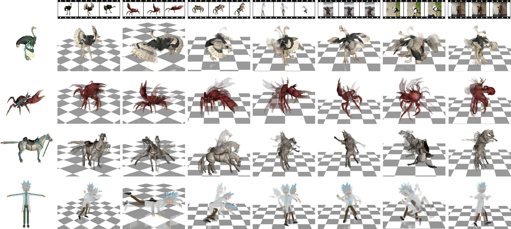

# CAST: Real-Time Motion Capture for Any Skeleton Topology

Pu Pang, Zhongfei Qing, Ling-Hao Chen, Songnan Li, Hua Huang, and Bo Hu.

[Installation](docs/installation.md) · [Model Weights](#model-weights) · [Evaluation](#evaluation) · [Inference](#inference) · [Blender](#blender) · [Remote Inference](#remote-inference) · [Training](#training)



*CAST animates four target skeletons (left) from each of seven input clips (top).*

CAST captures motion from RGB video for target skeletons with different topologies.
It uses GRACE (Gated Rotation Alignment and CorrEction) for topology-aware
analytic rotation correction. This repository contains the CAST training and
inference code, the CAST Live Blender addon, and a remote inference server with
the CAST Remote Live Blender client.

## Installation

The reference environment uses Python 3.10, PyTorch 2.7.0, and CUDA 12.8.
Linux is the default installation target.

See the [installation guide](docs/installation.md) for environment setup,
CUDA operator compilation, backbone assets, and optional SAM2 mask generation.
[Windows-specific instructions](docs/installation.md#windows) are included there.

## Dataset Preprocessing

Zoo and Mobjaverse provide the RGB/mask caches used for training and the
validation metrics below. Mixamo is a separate **cross-skeleton evaluation**
dataset: a source character's video is paired with a different target
character's skeleton and reference motion. See the
[preprocessing overview](preprocess/README.md) and the individual guides for
[Zoo](preprocess/zoo/README.md), [Mobjaverse](preprocess/mobjaverse/README.md),
and [Mixamo](preprocess/mixamo/README.md) to build their caches.

## Model Weights

CAST is available in two model families, CAST-B and CAST-L. Download the
checkpoint for your backbone and GRACE setting and use its matching configuration:

| Model | Configuration | Checkpoint |
| --- | --- | --- |
| CAST-B · DINOv2 | [Config](configs/experiment/CAST_B_dinov2.yaml) | [Download](https://huggingface.co/CAST-mocap/CAST/resolve/main/CAST_B_dinov2.pt) |
| CAST-B · DINOv2 · without GRACE | [Config](configs/experiment/CAST_B_dinov2_no_grace.yaml) | [Download](https://huggingface.co/CAST-mocap/CAST/resolve/main/CAST_B_dinov2_no_grace.pt) |
| CAST-B · DINOv3 | [Config](configs/experiment/CAST_B_dinov3.yaml) | [Download](https://huggingface.co/CAST-mocap/CAST/resolve/main/CAST_B_dinov3.pt) |
| CAST-B · DINOv3 · without GRACE | [Config](configs/experiment/CAST_B_dinov3_no_grace.yaml) | [Download](https://huggingface.co/CAST-mocap/CAST/resolve/main/CAST_B_dinov3_no_grace.pt) |
| CAST-L · DINOv3 | [Config](configs/experiment/CAST_L_dinov3.yaml) | [Download](https://huggingface.co/CAST-mocap/CAST/resolve/main/CAST_L_dinov3.pt) |

Each CAST checkpoint also requires the corresponding pretrained DINO backbone.
Download and configuration instructions are provided in the
[backbone setup section of the installation guide](docs/installation.md#backbone-assets).

## Evaluation

### Matched-rig

To evaluate a released checkpoint on its matching skeletons, prepare the
[Zoo](preprocess/zoo/README.md) and
[Mobjaverse](preprocess/mobjaverse/README.md) caches and set their
`dataset_root` paths in the matching model configuration. Set the DINO backbone
paths as described in [Installation](docs/installation.md#backbone-assets),
and place the CAST checkpoint in `checkpoints/` with its original filename.

Select the `model` in
[`scripts/eval_video2motion_matched_rig.sh`](scripts/eval_video2motion_matched_rig.sh), then run:

```bash
bash scripts/eval_video2motion_matched_rig.sh
```

The script evaluates Zoo, Mobjaverse seen, and Mobjaverse unseen. Paper metrics
(MPJPE, PA-MPJPE, MPJVE, and J2J/CD) are saved to
`results/eval/matched_rig/<model>/metrics.json`.

### Cross-skeleton

Build the [Mixamo evaluation cache](preprocess/mixamo/README.md) and set its
path as `mixamo_cache` in
[`scripts/eval_video2motion_cross_skeleton.sh`](scripts/eval_video2motion_cross_skeleton.sh).
Select the `model`, configure its DINO backbone in the matching model
configuration, and place its checkpoint in `checkpoints/`, then run:

```bash
bash scripts/eval_video2motion_cross_skeleton.sh
```

The script evaluates every directed source-video to target-skeleton pair in
`pairs.jsonl` against the target character's reference motion. Per-pair,
per-target, and overall metrics are saved to
`results/eval/cross_skeleton/<model>/metrics.json`.

## Inference

To drive and render a target mesh from an RGB video, configure the matching
[DINO backbone](docs/installation.md#backbone-assets) and place the CAST
checkpoint in `checkpoints/`. In
[`scripts/inference_video2motion.sh`](scripts/inference_video2motion.sh), select
the `model` and set `input_video`, `static_path` (the target character's
`static.npy`), and `mesh_source`. Use the original skinned FBX for Zoo or
Mixamo, or the original `raw_data.npz` for Mobjaverse. Set `blender` for FBX
assets. Provide an existing mask through `input_mask_video`, or set
`sam2_checkpoint` and `sam2_model_cfg` to generate one.

Choose `lighting_preset` (`zoo`, `mobj`, or `mixamo`), then run:

```bash
bash scripts/inference_video2motion.sh
```

The script extracts the mesh, predicts its motion, and writes the rendered video
to `results/inference/<model>/<skeleton>/<video-name>/visualization.mp4`.

For a new skinned FBX without an existing cache, generate its inference assets:

```bash
python -m utils.convert_fbx_to_cast --source character.fbx \
  --blender /path/to/blender --output-dir results/character_asset
```

This reads the FBX's declared axes, handedness and `UnitScaleFactor`, converts
both world and bone-local bases to OpenCV coordinates in meters, and extracts
`static.npy` and `mesh_asset.npz`. Rest transforms come from FBX BindPose or skin
cluster matrices; unskinned helpers use declared rest transforms with animation
disabled. The source root and all bones are retained. `skeleton.json` records
the source declarations, conversion matrices and rest provenance. Keep
`bind_transforms.npz` beside `static.npy` when rebuilding this mesh. A rig must
have one root; multiple roots or incomplete axis declarations produce an error
instead of an automatic hierarchy change or guessed coordinate system.

## Blender

Install **CAST Live** using the [Blender guide](blender/README.md). Configure
the local Python environment and model paths, load the weights, import a
character with a single armature (FBX, GLB, or `.blend`), and run a video.

Use a matching frame-wise causal checkpoint. The five offline checkpoints
listed above are not live-streaming weights.

## Remote Inference

1. Clone the complete repository onto a Linux GPU server. Follow the
   [server setup](blender/remote/server/README.md) to install dependencies,
   prepare a CAST-B or CAST-L causal checkpoint, and start the API and management
   console.
2. Follow the [client installation guide](blender/remote/client/README.md) to
   install **CAST Remote Live** in Blender and configure its external Python
   environment, server URL, and API key.
3. Import an FBX, wait for skeleton initialization, then click **Start Camera**
   and **Start Transfer**.

See the [remote documentation](blender/remote/README.md) for deployment,
configuration, and validation, or the [HTTP API reference](blender/remote/server/docs/API.md)
to connect another client. Use a matching causal checkpoint for the server;
the offline weights listed above cannot be used for live streaming.

## Training

Training reads the RGB/mask caches from
[Dataset Preprocessing](#dataset-preprocessing). Set their
`data.sources.*.dataset_root`, the [DINO backbone](docs/installation.md#backbone-assets)
paths, and `output.checkpoint_root` in the model configuration, then run:

```bash
bash scripts/train_video2motion.sh
```

`CONFIG` selects the configuration (default
`configs/experiment/CAST_B_dinov3.yaml`), `GPUS` the visible devices, `PYTHON_BIN`
the interpreter, and `RESUME_FROM_CHECKPOINT` resumes an interrupted run.
Without it, training starts from `train.init_from_checkpoint`. Logs are appended
to `logs/`.

The five configurations listed under [Model Weights](#model-weights) are the
training recipes for the released checkpoints.
`configs/experiment/CAST_L_dinov3_causal.yaml` is the frame-wise causal
fine-tune used by the live Blender engine.
`configs/experiment/CAST_B_dinov3_mask_completion.yaml` is the mask-completion
variant.

## License

The original CAST code is licensed under MIT; see [LICENSE](LICENSE).
Third-party code, model weights, and datasets retain their own license terms;
see [LICENSE-3RD-PARTY](LICENSE-3RD-PARTY) for bundled materials.

## Acknowledgements

We thank the authors of [MoCapAnything V2](https://github.com/phongdaot/MocapAnything)
for sharing their code, from which parts of our utility code are adapted.
We also thank the teams behind [DINOv2](https://github.com/facebookresearch/dinov2),
[DINOv3](https://github.com/facebookresearch/dinov3), and
[SAM2](https://github.com/facebookresearch/sam2) for making their code and
pretrained models available to the community.
